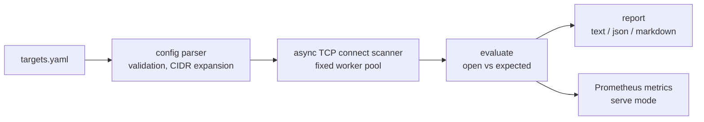

# Port Watch

[](https://github.com/SaeedHanjani/portwatch/actions/workflows/ci.yml)


**Port Watch tells you when the open ports on your network stop matching what you expect.**

A normal port scanner lists open ports and leaves the interpretation to you. Port Watch flips that around:
you declare which ports *should* be open on each host, and it reports the **drift**:

- 🔴 **Unexpected open port**: something is listening that should not be (a forgotten database, a debug port, a new service nobody announced).
- 🟡 **Expected port closed**: a service that should be reachable is down.

It runs as a one-shot CLI (CI-friendly exit codes) or as a long-lived container that exposes **Prometheus metrics**.

> ⚠️ **Only scan hosts and networks you own or have explicit written permission to test.**
> Unauthorized port scanning may be illegal in your jurisdiction.

## Quick start

```bash
git clone https://github.com/SaeedHanjani/portwatch && cd portwatch
cp targets.example.yaml targets.yaml      # edit it: your hosts, your expected ports
pip install .
portwatch scan -c targets.yaml
```

Example output:

```text
[ OK ] web-server (192.168.1.10)  open: 22, 80, 443
[FAIL] db-server (192.168.1.20)  open: 22, 3306, 6379
         unexpected open: 6379
         expected but closed: 5432

2 host(s) scanned, 1 with findings (1 unexpected open, 1 expected but closed)
```

| Exit code | Meaning |
| --- | --- |
| `0` | Everything matches the expectations |
| `1` | Drift detected (unexpected open and/or expected-but-closed ports) |
| `2` | Configuration error |

Output formats: `-f text` (default), `-f json`, `-f markdown`.

## Configuration

```yaml
timeout: 1.0        # seconds per connection attempt
concurrency: 200    # parallel connection attempts

targets:
  - name: web-server
    host: 192.168.1.10               # IP, hostname, or CIDR network (max 1024 hosts)
    expected_open: [22, 80, 443]     # ports that SHOULD be open
    ports: "1-1024,3306,5432,8080"   # ports to probe; expected_open is always included
```

`ports` accepts single ports, ranges and lists: `"22,80,8000-8100"`. The default is `1-1024`.

## Run it as a service (Docker + Prometheus)

```bash
docker run -d --name portwatch --network host \
  -v "$PWD/targets.yaml:/config/targets.yaml:ro" \
  ghcr.io/SaeedHanjani/portwatch:latest serve -c /config/targets.yaml --interval 300
```

`--network host` lets the container reach your LAN directly. See [`docker-compose.yml`](docker-compose.yml) for a hardened example
(read-only filesystem, all capabilities dropped, healthcheck).

Metrics are served on `:9877/metrics`:

| Metric | Meaning |
| --- | --- |
| `portwatch_port_open{target,host,port}` | `1` if open, `0` if expected but closed |
| `portwatch_unexpected_open_ports{target,host}` | number of unexpected open ports |
| `portwatch_expected_closed_ports{target,host}` | number of expected ports that are closed |
| `portwatch_scan_duration_seconds` | duration of the last scan |
| `portwatch_last_scan_timestamp_seconds` | when the last scan finished |

Prometheus scrape config and an example alert:

```yaml
scrape_configs:
  - job_name: portwatch
    static_configs:
      - targets: ["portwatch-host:9877"]

groups:
  - name: portwatch
    rules:
      - alert: UnexpectedOpenPort
        expr: portwatch_unexpected_open_ports > 0
        for: 10m
        labels: { severity: warning }
        annotations:
          summary: "Unexpected open port on {{ $labels.host }}"
      - alert: ExpectedServiceDown
        expr: portwatch_expected_closed_ports > 0
        for: 5m
        labels: { severity: critical }
```

## How it works



- **Async worker pool.** Probes are pulled from a shared iterator by a fixed number of workers, so memory stays flat even when
  scanning a `/24` over 1024 ports (a naive `asyncio.gather` would create ~260k tasks at once).
- **TCP connect scan.** It needs no root privileges and no raw sockets, so it runs fine in an unprivileged container.
- **Hosts shared by several targets are probed once**, on the union of their ports.

## CI/CD

[`.github/workflows/ci.yml`](.github/workflows/ci.yml) runs on every push and pull request:

1. **Lint & test**: `ruff` + `pytest` on Python 3.10, 3.11 and 3.12.
2. **Build** the Docker image (multi-stage, non-root user).
3. **Smoke test** the built image against a real `nginx` container, including a negative test that expects exit code `1`.
4. **Trivy** scan: the build fails on fixable HIGH/CRITICAL vulnerabilities.
5. **Publish** to GitHub Container Registry (`ghcr.io`) on `main` and on `v*` tags. Pull requests never publish.

Dependabot keeps GitHub Actions, pip and Docker base images up to date.

## Development

```bash
python -m venv .venv && source .venv/bin/activate
pip install -e ".[dev]"
ruff check . && ruff format --check . && pytest
```

## Limitations and roadmap

- TCP only; no UDP scanning and no service/banner detection.
- A closed and a filtered (firewalled) port look the same to a connect scan: both count as "not open".
- [ ] Notifications (Telegram / email / webhook) when drift appears
- [ ] Baseline mode: record the current state as the expected state
- [ ] Helm chart for running it on Kubernetes
- [ ] Ready-made Grafana dashboard

## What I learned

<!-- Fill this in with your own words: design decisions, problems you hit, what you would do differently.
     This section is what makes the repo stand out. -->

## License

MIT. See [LICENSE](LICENSE).
